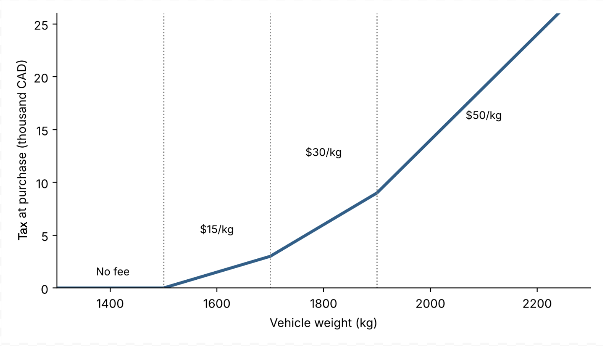

# Public Summary: Weighing the Cost

**A Progressive Weight-Based Vehicle Tax and Consumer Education to Address Vehicle Upsizing in Canada**

15 November 2026  
ISCI 3A12  
**Group 1**  
Jasleen Kalkat, Tvara Parikh, Ann Phillip, Gurdit Sra, Ollin Rath

## Bigger Vehicles, Bigger Emissions

Canada’s climate rules focus on what powers a vehicle, not how big it is. Light trucks rose from 50% of Canadian passenger vehicle sales in 2010 to 70% in 2022 (Government of Canada 2026b). SUVs, even electric ones, use 15-25% more energy and emit 20-25% more CO₂ per kilometre than sedans, and they need more raw materials to build (Cheshmehzangi et al. 2025; Zhu et al. 2026). This upsizing of cars has erased much of the progress from efficiency and electrification (Cozzi and Petropoulos 2024).

## Our proposal

1. **A weight-based tax on new vehicles.** Vehicles of 1,500 kg or less pay nothing. Above that, each extra kilogram costs more as vehicles get heavier (Figure 1), following France's weight tax (République Française 2026).

2. **A short education module before purchase.** Buyers would see their chosen vehicle's estimated five-year fuel and ownership costs, followed by the CO₂ emissions.

*Figure 1: Proposed weight-based tax: 0$ up to 1,500 kg, then $15/kg (1,501-1,700 kg), $30/kg (1,701-1900 kg) and $50/kg above 1.900 kg. Fee schedule designed by the authors, inspired by République Française (2026).*

## Why Should It Work?

Pigou (1920) argued that when buyers don’t pay for harms their choices impose on others, a tax can close the gap. There are precedents and models such as Simon (1955) behavioural model that showcase how buyers might make purchases, which can guide the making of a meaningful educational module that could prevent decisions from being constrained by incomplete information. After Norway tied its registration tax to CO₂, average new-car emissions fell from 177 to 159 g/km within a year (Yan and Eskeland 2018). France's upfront tax shifted more car buyers away from high-emission vehicles than Germany’s and Sweden’s annual car tax (Klier and Linn 2015). Finland’s CO2-based taxes lowered demand for heavy vehicles (Harju et al. 2016).

## Can Canada do it?

There are three perspectives to consider when thinking about whether or not a policy would be successful. Financially the policy works since the tax raises revenue, which could fund the module. Technically it works since vehicle weight is already reported for every model sold in Canada but batteries make electric vehicles heavier, so Canada needs a weight allowance or exemption (depending on the car), as in France (Natural Resources Canada 2026; République Française 2026). The greatest challenge is social and political acceptance. Rural and northern drivers face long distances and harsh winters making SUVs the only feasible car for them to purchase. Therefore the implementation of this policy can lead to push back from communities that truly require bigger vehicles.

## What We Don’t Know

Modelling suggests such policies slow the growth in vehicle weight without reversing it (Axsen and Bhardwaj 2026). Education alone is weak: in one experiment, fuel-cost information did not change purchases (Allcott and Knittel 2019). Buyers respond more to costs than CO₂ figures (Codagnone et al. 2016), so the module leads with costs. The tax also weighs more on lower-income households, and exact emission savings for Canada remain uncalculated. Our findings come from a review of existing studies and international case studies, not new data.

## The Bottom Line

Phase the tax in gradually, starting with the heaviest non-commercial vehicles, with a battery-weight allowance for electric vehicles and exemptions for genuine need. It cannot decarbonize transport alone, but can stop bigger vehicles from undoing the progress Canada makes elsewhere.

## References

Allcott, Hunt, and Christopher Knittel. 2019. “Are Consumers Poorly Informed about Fuel Economy? Evidence from Two Experiments.” *American Economic Journal: Economic Policy* 11 (1): 1–37. https://doi.org/10.1257/pol.20170019.

Axsen, Jonn, and Chandan Bhardwaj. 2026. “Policy Can Downsize Passenger Vehicles and Cut Climate Emissions.” *Environmental Research Letters* 21 (4): 044002. https://doi.org/10.1088/1748-9326/ae41d0.

Canada. 2026a. *2026 Fuel Consumption Guide*.

Canada, Transport. 2026b. “Electric Vehicle Affordability Program: Questions and Answers.” AHSB, AHSB, February 12. https://tc.canada.ca/en/road-transportation/innovative-technologies/electric-vehicles/electric-vehicle-affordability-program/questions-answers.

Canada, Transport. 2026c. “Zero-Emission Trucking Program.” AEBA 18767108, AEBA, April 10. https://tc.canada.ca/en/road-transportation/innovative-technologies/electric-vehicles/zero-emission-trucking-program.

Cheshmehzangi, Ali, Zaheer Allam, Baojie He, and Zhaohui Su. 2025. “Climate Change Efforts vs. the Growing Popularity of Larger Private Vehicles: A Contradiction in Motion.” *Human Settlements and Sustainability* 1 (3): 180–87. https://doi.org/10.1016/j.hssust.2025.07.002.

Codagnone, Cristiano, Giuseppe Alessandro Veltri, Francesco Bogliacino, et al. 2016. “Labels as Nudges? An Experimental Study of Car Eco-Labels.” *Economia Politica* 33 (3): 403–32. https://doi.org/10.1007/s40888-016-0042-2.

Cozzi, Laura, and Apostolos Petropoulos. 2019. “Growing Preference for SUVs Challenges Emissions Reductions in Passenger Car Market.” IEA, October 14. https://www.iea.org/commentaries/growing-preference-for-suvs-challenges-emissions-reductions-in-passenger-car-market.

Cozzi, Laura, and Apostolos Petropoulos. 2024. “SUVs Are Setting New Sales Records Each Year – and so Are Their Emissions.” IEA, May 28. https://www.iea.org/commentaries/suvs-are-setting-new-sales-records-each-year-and-so-are-their-emissions.

Government of Canada, Public Works and Government Services Canada. 2026a. “Canada Gazette, Part 1, Volume 160, Number 33: Regulations Amending the Passenger Automobile and Light Truck Greenhouse Gas Emission Regulations.” Government of Canada, Public Works and Government Services Canada, Integrated Services Branch, Canada Gazette, August 15. https://gazette.gc.ca/rp-pr/p1/2026/2026-08-15/html/reg2-eng.html.

Government of Canada, Public Works and Government Services Canada. 2026b. “Canada Gazette, Part 1, Volume 160, Number 44: GOVERNMENT NOTICES.” Government of Canada, Public Works and Government Services Canada, Integrated Services Branch, Canada Gazette, November 7. https://gazette.gc.ca/rp-pr/p1/2026/2026-10-31/html/notice-avis-eng.html.

Harju, Jarkko, Tuomas Kosonen, and Joel Slemrod. n.d. *Behavioral Responses to Pigouvian Car Taxes: Vehicular Choice and Missing Miles*.

Klier, Thomas, and Joshua Linn. 2015. “Using Taxes to Reduce Carbon Dioxide Emissions Rates of New Passenger Vehicles: Evidence from France, Germany, and Sweden.” *American Economic Journal: Economic Policy* 7 (1): 212–42. https://doi.org/10.1257/pol.20120256.

Pigou, Arthur. 2017. *The Economics of Welfare*. Routledge. https://doi.org/10.4324/9781351304368.

République Française. n.d. “Tax on the mass in running order of passenger vehicles (mass penalty).” Accessed November 17, 2026. https://www.service-public.gouv.fr/particuliers/vosdroits/F35950?lang=en.

Simon, Herbert A. 1955. “A Behavioral Model of Rational Choice.” *The Quarterly Journal of Economics* 69 (1): 99–118. https://doi.org/10.2307/1884852.

Yan, Shiyu, and Gunnar S. Eskeland. 2018. “Greening the Vehicle Fleet: Norway’s CO2-Differentiated Registration Tax.” *Journal of Environmental Economics and Management* 91 (September): 247–62. https://doi.org/10.1016/j.jeem.2018.08.018.

Zhu, Yan, Jie Zhang, and Yan Long. 2026. “A Comparative Life Cycle Assessment of Carbon Emissions for Battery Electric Vehicle Types.” *Energies* 19 (2): 377. https://doi.org/10.3390/en19020377.
